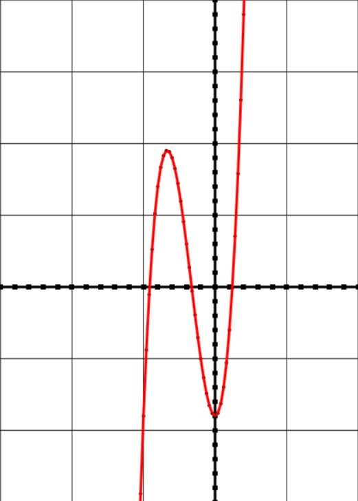

# 🚧 C-Plane Graph Plotter (Inspired by Desmos)

This is a work-in-progress, canvas-based graphing calculator built with vanilla JavaScript. It's inspired by **Desmos**, but designed to run entirely in the browser without frameworks or dependencies.

> ✨ It's not finished yet — but we will get there.

---

## 🔍 Features

- 📈 Plot custom user equations like `2x + 1`, `x**2`, `Math.sin(x)`, etc.
- 🧮 Coordinate plane rendered manually using the HTML5 `<canvas>`.
- 🖊️ Live equation editing — changes update the graph in real time.
- 🔍 Zoom control via slider.
- 🌀 Smooth animation loop using `requestAnimationFrame()`.

---

## 📁 File Structure

```
project-root/
│
├── index.html # HTML layout with input fields and canvas
├── main.js # Main JS: handles drawing, UI, animation
│
├── Math/
│ ├── equation.js # Equation class — parses and plots equations
│ ├── point.js # (Optional) point class for future features
│ └── segment.js # (Optional) segment class for drawing lines
│
└── UI/
└── c-plane.js # Cplane class — draws axes, grid, and ticks
```


---

## 💻 How It Works

1. User types an equation (e.g. `x**2 + 3x + 2`) into the input box.
2. The input string is parsed into a JavaScript function (e.g. via `eval`).
3. The equation is sampled over a range of x-values to produce points.
4. Points are converted into canvas coordinates based on zoom level.
5. The graph is drawn onto the custom coordinate plane.

---

## 🧪 Try These Inputs

| Input               | Description         |
|---------------------|---------------------|
| `2x + 1`            | Straight line       |
| `x**2`              | Parabola            |
| `x**3 - 3x`         | Cubic curve         |
| `Math.sin(x)`       | Sine wave           |
| `Math.exp(x)`       | Exponential growth  |

> ✅ Supports `Math` functions like `Math.sin`, `Math.cos`, `Math.exp`, etc.

---

## 🖼️ Demo Preview

> 

---

## 🚀 Getting Started

You don't need to install anything. Just:

1. Clone or download the repository.
2. Open `index.html` in any modern browser.
3. Type your equation and adjust the zoom to see the plot.

---

## 🧱 Future Roadmap

- [ ] Mouse-based panning
- [ ] Multiple equations
- [ ] Axes labels and grid numbers
- [ ] Improved input validation
- [ ] Export graph to image
- [ ] Dark mode

---

## 💡 Inspiration

This project is a learning experiment and creative tribute to **[Desmos](https://www.desmos.com/)** — a truly amazing graphing tool. This version explores how far you can go using raw JavaScript, canvas rendering, and a bit of imagination.

---

## 🤝 Contributing

Not actively open to contributions just yet — but if you're curious or want to collaborate, feel free to reach out or fork the repo!

---

## ⚖️ License

Unlicensed / For educational and experimental use.

---

> Made with ❤️ and math.
